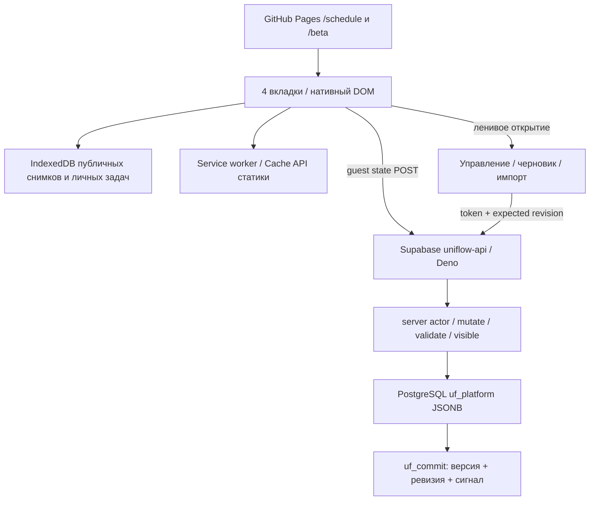

# Архитектура

## Границы ответственности

- DOM helper создаёт структуру, dynamic text проходит через textContent. Студенческая оболочка не содержит innerHTML, внешних скриптов и авторизационных токенов.
- Унаследованные staff templates экранируют данные h(), затем DOMParser и allowlist пропускают только известные элементы/атрибуты. Это совместимый renderer собственных шаблонов, не универсальная поддержка произвольного пользовательского HTML. CSP запрещает inline script и внешние ресурсы. Style attrs удаляются.
- Student time engine вычисляет instants UTC+5, occurrence boundaries, текущую/следующую пару, окна; исходные даты/время и metadata не переписывает. Backend pure core проверяет глобальные ссылки и права. Оба слоя покрыты тестами.
- Guest snapshot пересанитизируется и при записи и при чтении: приватные коллекции/аккаунты не сохраняются, задания/объявления ограничены текущей группой и подгруппой. Эпоха запроса не даёт позднему ответу прежней группы заменить новую.
- Live API — POST с apikey, защищённые операции дополнительно с opaque token. Настройки/личные задания не выходят с устройства.
- Сеть обновляет снимок при online/visibility и раз в минуту в видимой вкладке. Работающий ввод/диалог не перерисовывается. Realtime SDK исключён из начальной загрузки; исходный серверный uf_signal совместим с другими клиентами.
- Service worker cache-first для versioned shell, stale-while-revalidate для публичного release snapshot; настоящий POST state кеширует IDB-клиент, а не SW. Staff навигация не подменяется студентским index. Разные base paths получают разные cache names.

## Совместимость

Владелец выбрал uf_platform / beta-XLSX общим источником 6 ноября 2026. Нет destructive DB migration: production artifact переносит тот же student entrypoint в корень; `/beta/` и query demo сохраняются. Legacy group_schedule и исходный HTML остаются для отката. Существующие localStorage keys группы и демо читаются, IDs 524 занятий/metadata сохранены.

Общая SQL revision и JSONB пока сохранены, чтобы не вводить скрытую миграцию данных. Запись блокируется и проверяется сервером; клиентская проверка — дополнительная помощь, не средство авторизации. При больших объёмах требуется отдельное нормализованное хранение, это не часть текущего UI cutover.

## Ограничения платформы

Нет надёжного локального планировщика уведомлений при закрытом браузере; используется ICS/VALARM. Service worker может быть выгружен платформой. Недоступный IndexedDB имеет localStorage и memory fallback, но браузер может очистить данные. Реальные каникулы/границы семестра не выдумываются: учитываются только введённые optional поля. Загрузка приложения за <1 секунду и пользовательские сценарии проверяются измерениями, не выводятся из малого размера JS.

## Изоляция выпусков после cutover

Student entry в итоговом artifact — минифицированный inline ESmodule и CSS с CSP-хешами. Данные остаются JSON/IndexedDB, current/next вычисляются в браузере. Source entry остаётся читаемыми ES modules для разработки. Календарная библиотека входит в этот небольшой student bundle, а управление/шаблоны загружаются только при открытии управления.

Beta builder требует проверенный production TAR из последнего immutable GitHub Release: checksum, sourceRef и release.json опубликованной главной. Он заменяет только beta; итоговый digest всех файлов вне beta и байты root worker сравниваются с базой. Модель в beta/model.mjs отдельная отproduction; backend handlers/SQL в artifact не попадают. Отсутствующая или неподтверждённая база — ошибка, а не откат на legacy index.
